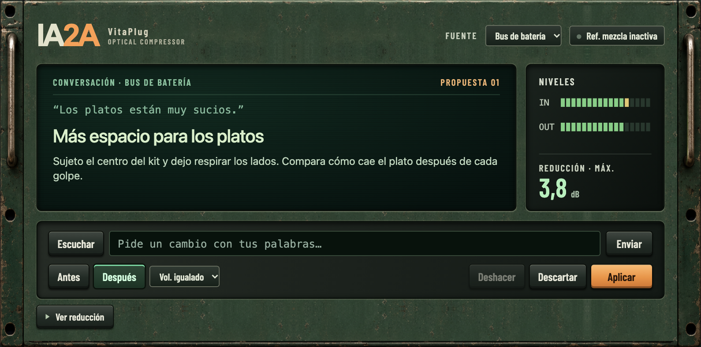
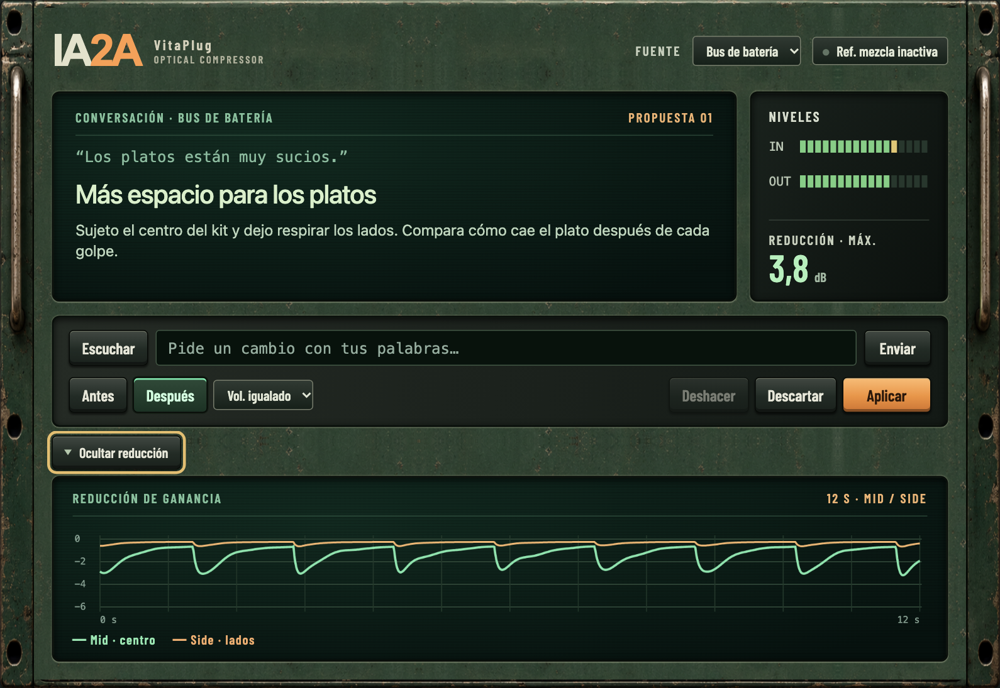
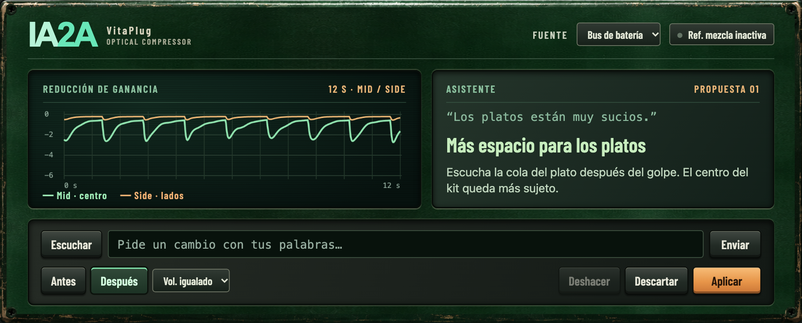
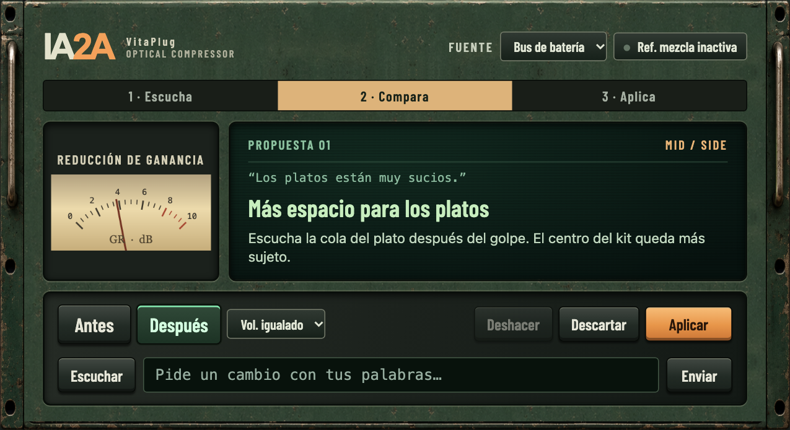

# IA2A · Tres propuestas de frontal

Las tres maquetas parten del mismo bus de batería y de la petición «Los platos están muy sucios». Al elegir Voz en el selector de fuente, se muestra el segundo ejemplo. Los medidores y las respuestas son ilustrativos. El comparador permite ensayar la interacción sin procesar audio.

Abrir [el comparador](index.html) localmente en un navegador. Se puede alternar entre Antes y Después, cambiar el nivel de comparación, aplicar, deshacer y pedir una variación.

## A · Conversación · Frontal elegido

La petición y la respuesta se leen juntas. Los indicadores de entrada, salida y reducción dejan espacio para explicar qué escuchar.

El botón **Ver reducción** despliega el historial de B bajo los controles de escucha.

## B · Centro y lados

El historial de reducción muestra cómo se sujetan los golpes del centro y cuánto se libera el ambiente estéreo. La explicación aparece al lado de las dos trazas.

## C · Escucha guiada

Tres pasos indican en qué momento se encuentra el usuario. Los botones grandes de Antes y Después y el vúmetro de aguja concentran la atención en la comparación.

## Recursos de las maquetas

La carcasa combina muestras del frontal de IAQ8 y de la placa de LAB2C 0.1.11. La tipografía Barlow Condensed se distribuye con su [licencia OFL](assets/OFL.txt).
